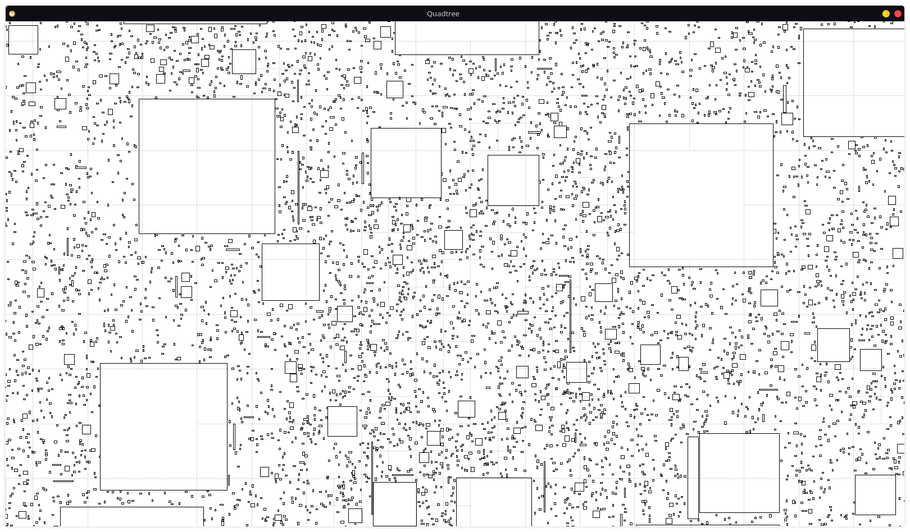

This is a C Quadtree that was written to be faster than "multi grids" and then even single layered grids. It focuses on achieving the highest speeds, only then optimizing memory. Unlike probably most out there, it has actual highly optimized collision detection capabilities, not just support for `insert` and `query`.

# Demonstration of power

On my laptop at least, this Quadtree handles 1,000,000 entities of wildly varying sizes at around 15.6mspt (so 60 FPS), with 1,000x 1920x1080 queries taking around 0.26mspt. Half that many entities in a quarter of the area, so twice as dense, takes around 9.7mspt. Here's a fraction of the simulation:

If you want to run the simulation yourself, just execute `make` and see `test.c` for details. Naturally, the time figures given are only for demonstrative purposes only, as they can vary.

For similar settings to my [HSHG](https://github.com/supahero1/hshg) (500k same sized entities and other parameters), it yields around 8.1mspt, while the HSHG takes around 20mspt on the same machine, so it's about 2.5x faster. Finally I'm able to say hierarchical structures rock the game when written properly.

# Disclaimer

Made for my private use. Stability or correctness is not guaranteed (fork it or contribute), although I have tested it a bunch.
